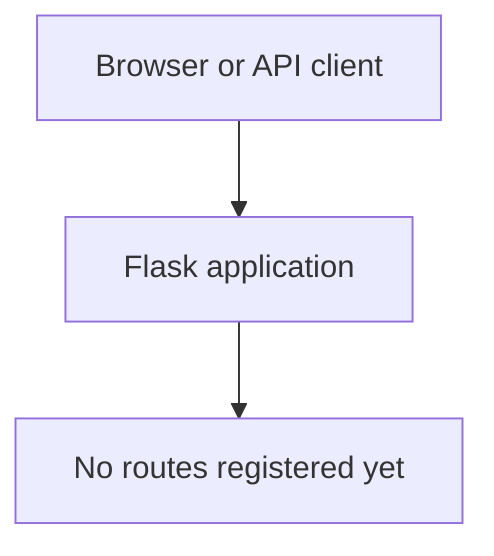

# Flask App Project Reference

This document is the starting reference for building the application. Update the route inventory and diagram whenever routes are added or changed.

## Current Project State

- No `app.py` exists in the repository yet.
- No Flask route declarations were found in the current project files.
- The only application file present before this README was `actgit.py`.
- The current local Git branch is `feature/w5v01`.
- The remote repository already contains the branches listed below.

## Route Inventory

There are currently no application routes to list. Add one row per route from `app.py`, including its HTTP method, exact URL, and behavior.

| Method | URL | Behavior | Source |
| --- | --- | --- | --- |
| None | None | No routes are defined yet. | `app.py` is not present |

## Route Map

When `app.py` is added, replace the empty-state node with each registered route and show the destination or response it provides.

## Branches

| Branch | Location | Notes |
| --- | --- | --- |
| `feature/w5v01` | Local | Current branch; local initial project version. |
| `feature-w5v01` | Remote (`origin`) | Publishes local `feature/w5v01`; the remote already has a `feature` branch, so a nested `feature/w5v01` ref cannot be created. |
| `feature` | Remote (`origin`) | Existing remote branch. |
| `hotfix` | Remote (`origin`) | Existing remote branch. |
| `main` | Remote (`origin`) | Existing remote branch. |
| `patch` | Remote (`origin`) | Existing remote branch. |
| `release` | Remote (`origin`) | Existing remote branch. |
| `release2` | Remote (`origin`) | Existing remote branch. |
| `release3` | Remote (`origin`) | Existing remote branch. |

The requested GitHub remote is `https://github.com/20243rd057-droid/flask.git`. Update this section as additional branches are created or discovered.

## Updating This Reference

For every route declared in `app.py`, document its HTTP method, exact URL, purpose, and important request/response behavior in the inventory. Keep the Mermaid route map synchronized with the route definitions.